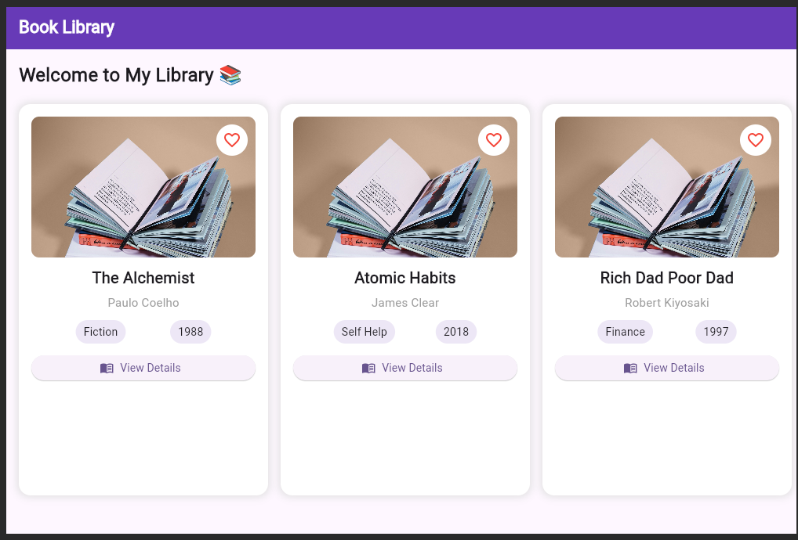

# Book Library Management System

A responsive Flutter application developed to manage and organize books with a simple and user-friendly interface. This project also demonstrates important Flutter concepts through 10 practical experiments.

## Features

- View the list of books
- Search for books
- Add new books
- Update book details
- Delete books
- View detailed book information
- Responsive user interface
- Navigation between screens

## Technologies Used

- Flutter
- Dart
- Visual Studio Code
- Git and GitHub

## Flutter Experiments

This project covers the following 10 Flutter concepts:

1. Dart Basics
2. Flutter Widgets and Layouts
3. Responsive UI Design
4. Navigation Between Screens
5. State Management
6. Themes and Styling
7. Forms and Validation
8. Animations
9. REST API Integration
10. Testing and Debugging

## Screenshots

Screenshots of the project and all 10 experiments are available in the `screenshots` folder.

### Home Screen



## Project Structure

```text
book_library_app/
│
├── lib/
│   ├── main.dart
│   └── experiments/
│       ├── exp1_dart_basics.dart
│       ├── exp2_flutter_widgets.dart
│       ├── exp3_responsive_ui.dart
│       ├── exp4_navigation.dart
│       ├── exp5_state_management.dart
│       ├── exp6_themes_styling.dart
│       ├── exp7_forms_validation.dart
│       ├── exp8_animations.dart
│       ├── exp9_rest_api.dart
│       └── exp10_testing_debugging.dart
│
├── screenshots/
│   └── Project and experiment screenshots
│
├── pubspec.yaml
└── README.md
```

## Getting Started

1. Install Flutter and Dart.
2. Clone this repository.
3. Open the project folder in Visual Studio Code.
4. Install the dependencies:

```bash
flutter pub get
```

5. Run the application:

```bash
flutter run -d chrome
```

## Author

Book Library Management System — Flutter Lab Project.
